# Using the `/roller-security` Skill

```mermaid
graph TD
    __start__([__start__])
    guard_workspace["guard_workspace (Tier 0)"]
    ingest_and_ack["ingest_and_ack (Tier 0 + Tier 1)"]
    gate_acknowledge{"Gate 1: gate_acknowledge"}
    investigate_codebase["investigate_codebase (Tier 2)"]
    gate_pmc_decision{"Gate 2: gate_pmc_decision"}
    handle_rejection["handle_rejection (Tier 1 + Tier 0)"]
    assess_severity_and_cve["assess_severity_and_cve (Tier 2 + Tier 1)"]
    gate_cve_request{"Gate 3: gate_cve_request"}
    verify_fix_and_audit["verify_fix_and_audit (Tier 0 + Tier 2)"]
    draft_pr_and_reporter_review["draft_pr_and_reporter_review (Tier 1 air-gapped)"]
    gate_reporter_review_and_merge{"Gate 4: gate_reporter_review_and_merge"}
    verify_merge_and_pr["verify_merge_and_pr (Tier 0)"]
    gate_release_handoff{"Gate 5: gate_release_handoff"}
    verify_release_and_prepare_disclosure["verify_release_and_prepare_disclosure (Tier 0 + Tier 1)"]
    gate_disclosure_and_close{"Gate 6: gate_disclosure_and_close"}
    __end__([__end__])

    __start__ --> guard_workspace
    guard_workspace -. unsafe .-> __end__
    guard_workspace -. safe .-> ingest_and_ack
    ingest_and_ack --> gate_acknowledge
    gate_acknowledge --> investigate_codebase
    investigate_codebase --> gate_pmc_decision
    gate_pmc_decision -. close_rejected .-> handle_rejection
    handle_rejection --> __end__
    gate_pmc_decision -. accept .-> assess_severity_and_cve
    assess_severity_and_cve --> gate_cve_request
    gate_cve_request --> verify_fix_and_audit
    verify_fix_and_audit -. needs_work .-> gate_cve_request
    verify_fix_and_audit -. clean .-> draft_pr_and_reporter_review
    draft_pr_and_reporter_review --> gate_reporter_review_and_merge
    gate_reporter_review_and_merge --> verify_merge_and_pr
    verify_merge_and_pr -. retry .-> gate_reporter_review_and_merge
    verify_merge_and_pr -. ok .-> gate_release_handoff
    gate_release_handoff --> verify_release_and_prepare_disclosure
    verify_release_and_prepare_disclosure -. retry .-> gate_release_handoff
    verify_release_and_prepare_disclosure -. ok .-> gate_disclosure_and_close
    gate_disclosure_and_close -. retry .-> gate_disclosure_and_close
    gate_disclosure_and_close -. done .-> __end__
```

The `/roller-security` skill guides you through Apache Roller's private vulnerability response workflow—from initial report intake to CVE publication—using a local SQLite database (`triage-<year>/cases.db`) and plain Markdown views (`CASE.md`, `SUMMARY_BOARD.md`). No Obsidian or external note app is required.



---

## 1. One-Time Setup

Install the skill's Python environment once:

```bash
cd skills/roller-security
uv sync --extra anthropic   # or --extra all-llms / --extra ollama
```

Make sure your private triage directory is excluded from Git (in `.git/info/exclude`, **not** `.gitignore`):

```bash
echo '/triage-*/' >> .git/info/exclude
```

Set your API key (e.g. `ANTHROPIC_API_KEY`)—or if you want private reports to stay 100% on your machine, install `--extra ollama` and ask the agent to run in `--local-llm` mode.

---

## 2. Day-to-Day Workflow with `/roller-security`

After setup, you do not need to run CLI commands manually. Just invoke `/roller-security` in Claude Code, Codex, or Antigravity and tell it what you want to do.

### Start a new report
Drop the incoming vulnerability email into your private `triage-<year>/` folder, then say:

> `/roller-security` Triage `triage-2026/incoming-report.eml` as a new case in `triage-2026/`.

The skill verifies `triage-2026/` is excluded from Git, creates the case record, and drafts a neutral receipt acknowledgement for you to review and send.

### Move a case through each approval gate
The workflow pauses at every external or PMC decision so nothing is sent, merged, or published without your sign-off. Just tell the assistant as each step completes:

1. **After sending the acknowledgement:**
   > `/roller-security` I sent the acknowledgement for `2026-01-feed-parser`. Investigate it.
   *(Produces verified evidence vs. inference in `IMPLEMENTATION.md` for PMC review.)*

2. **After the PMC decides:**
   > `/roller-security` The PMC accepted `2026-01-feed-parser` for Roller `7.0.0`.
   *(Rates severity, prepares `CVE_FORM.md`, and drafts the acceptance email. If rejected instead, say "The PMC rejected it" and the case closes cleanly.)*

3. **After requesting the CVE and writing your fix on a neutral branch:**
   > `/roller-security` Record `CVE-2026-12345` on `2026-01-feed-parser`, branch `harden-feed-parser`, test `FeedParserTest`, and run the disclosure checks.
   *(Runs tests, `check-private.sh`, cross-case overlap checks, and drafts a leak-safe PR description + reporter review email.)*

4. **After reporter review and merging the PR:**
   > `/roller-security` Reporter approved `2026-01-feed-parser` and PR #42 merged as commit `<merge-sha>`.
   *(Lints the PR and pauses until the fixed Roller release is published.)*

5. **When preparing the release:**
   > `/roller-security` Export public release briefs for Roller `7.0.0`.
   *(Outputs leak-safe summaries with no CVE IDs or withheld details for the release notes.)*

6. **After the release is live and advisories are sent:**
   > `/roller-security` Roller `7.0.0` is tagged as `roller-7.0.0`. Verify the fix commit, then close `2026-01-feed-parser` with announcement `<lists.apache.org URL>`.
   *(Verifies the fix is in the release tag, checks the archive URLs, drafts the reporter notification email, and marks the case complete.)*

### Check your board anytime
> `/roller-security` Show me the security board for `triage-2026/`.

> `/roller-security` Show open cases assigned to me for Roller `7.0.0`.

---

## 3. Quick Safety Reminders

- **Never commit `triage-*/` or `cases.db`:** Everything private stays in `triage-<year>/` (excluded via `.git/info/exclude`).
- **Back up with `cp -a`:** On macOS, use `cp -a triage-2026 ~/private/triage-2026-backup` so symlinks and permissions are preserved.
- **Keep fixes neutral until disclosure:** Never mention CVEs or flaw names in branch names, commit messages, PR bodies, or test names.

---

## 4. Optional: Running Directly Without an AI Agent

If you prefer to drive the workflow yourself from the terminal, run:

```bash
cd skills/roller-security
uv run roller-security --help
```

See [README.md](README.md) for the full CLI reference.
